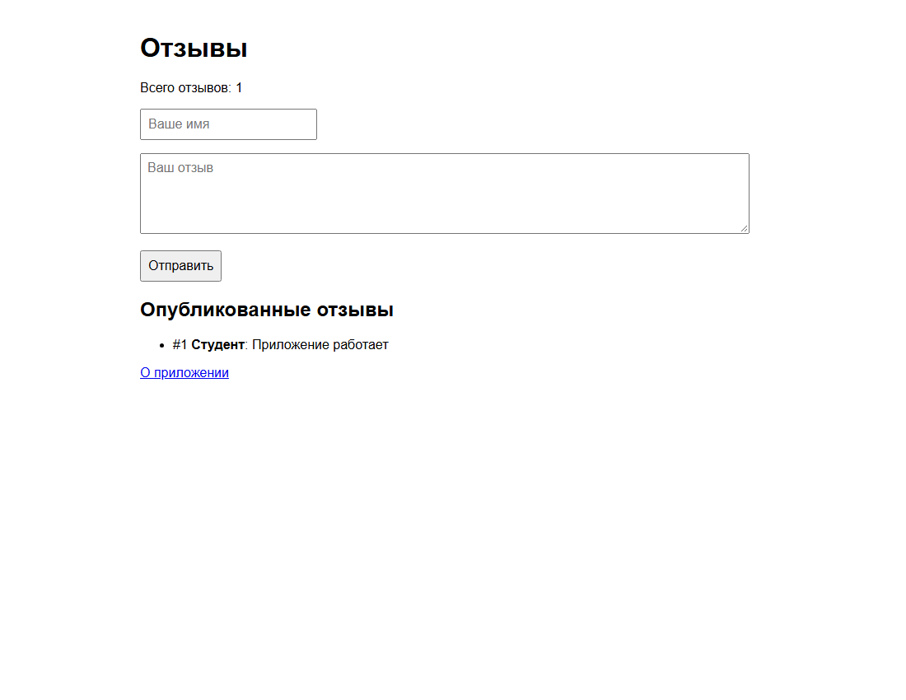

# Практическая работа 11 — сайт для отзывов

## Краткий отчёт

Сайт для добавления и просмотра отзывов.

## Выполнение по заданию

### 1. Данные и шаблон

Структура `Feedback` и срез хранят отзывы. `PageData` передаёт отзывы и их количество в HTML-шаблон.

### 2. Маршруты

`GET /` показывает форму и отзывы, `POST /feedback` добавляет отзыв, `GET /about` показывает описание.

### 3. Проверка

Проверены два отзыва, подсчёт, пустые поля, страница о приложении и ответ 405 для GET на `/feedback`.

## Запуск

В PowerShell из этой папки:

```powershell
go run .
```

Откройте `http://localhost:8080`. Остановка сервера — Ctrl+C. После перезапуска данные очищаются.

## Скриншот выполнения



## Вывод

Отзывы хранятся в памяти. Форма отправляет POST-запрос, после сохранения сервер перенаправляет на главную страницу.
